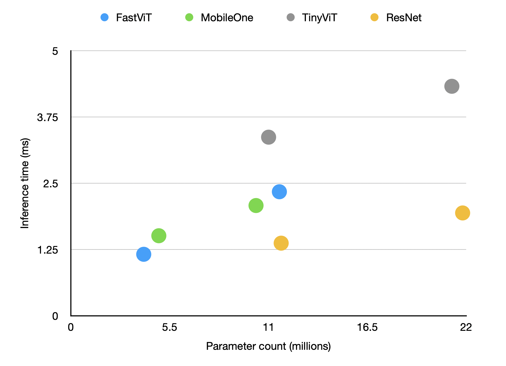

# CNNs and vision transformers for smartphone inference

**2024 SYS843 course project · Adarley Luiz Grando Filho**

Could a compact image classifier support a future on-device recognition feature in **Fruit Map**, my nonprofit fruit-tree mapping app? I explored the accuracy, training, and smartphone inference trade-offs of ResNet, MobileOne, TinyViT, and FastViT. This was exploratory work. Recognition was not shipped in Fruit Map; this repository does not validate plant recognition.

**[Read the report (PDF)](report/sys843-report-en.pdf)** · [Evidence audit and 2026 corrections](report/AUDIT.md) · [Reproduction and device guide](report/REPRODUCING.md)

## What I implemented

The repository contains my Python workflow for CIFAR-10 training/fine-tuning, Optuna search, metadata and plots, and pretrained-model conversion to Core ML. The report describes my model comparison and iPhone 13 Pro measurements. Architectures and pretrained weights come from **timm/PyTorch**, and Core ML/Xcode supplies conversion and profiling; I did not implement these architectures from scratch. Report figures from other authors are cited there. The single 2024 code snapshot and saved artifacts support this scope, but do not establish the exact script revisions behind every historical run or the origin of every code fragment.

Two separate experiment tracks answer different questions:

1. **CIFAR-10:** train FastViT-T8 from scratch versus fine-tune pretrained weights, inspecting learning curves and classification errors. Four saved checkpoints represent two continuing training histories, not four independent trials.
2. **Core ML/iPhone:** convert eight externally pretrained ImageNet models and compare model-only prediction, load, and compile times on an iPhone 13 Pro. ImageNet accuracy is externally sourced, not measured here. Pretraining recipes differ, including ImageNet-22k distillation for TinyViT.

## Results and interpretation

| Track / artifact | Result | Evidence status |
| --- | --- | --- |
| CIFAR-10 checkpoint 001, scratch-labelled, epoch 138 | **92.80%** (9,280/10,000) | New full official-test evaluation, Nov. 23, 2026 |
| CIFAR-10 checkpoint 002, same history, epoch 154 | 92.41% | Same new evaluation protocol |
| CIFAR-10 checkpoint 003, pretrained-labelled, epoch 105 | **96.17%** (9,617/10,000) | Same new evaluation protocol |
| CIFAR-10 checkpoint 004, same history, epoch 113 | 95.70% | Same new evaluation protocol |
| iPhone 13 Pro: FastViT-T8 / TinyViT-21M | **1.16 / 4.33 ms** median prediction | Historical 2024 report; raw Xcode reports unavailable |

The new checkpoint evaluation uses deterministic timm preprocessing at 256 × 256 and the official 10,000-image CIFAR-10 test set. It runs inference only on archived weights. [Machine-readable results](report/checkpoint-evaluation-2026-11-23.json) include hashes, transforms, versions, counts, and confusion matrices. Initialization labels follow historical filenames; exact training provenance remains unresolved. All checkpoints are shown, without selecting one using the new test scores.

The original report's **85.28% / 88.66%** match saved metadata, but **cannot be certified as held-out test accuracies**: the published script evaluates the augmented validation subset as “test,” and does not restore its best validation weights. The report now explains these corrections; new measurements do not reproduce the 2024 training.



*Existing 2024 figure. These are model-only device timings, not camera-to-result latency. Each family has two variants; the full table is in the report.*

The useful findings are practical: parameter count alone did not predict device latency; prediction and model startup costs need separate budgets; and the recorded fine-tuning curves motivated a lower learning rate than scratch training. FastViT-T8 belongs to the FastViT family but uses convolutional RepMixer blocks without self-attention; SA12 includes attention. These experiments do not establish a universal CNN-versus-transformer ranking.

The main lesson is to make the evaluation boundary explicit: separate augmentation, validation selection, final testing, external benchmarks, and device timings. This small exploratory study has no repeated-seed uncertainty, verified plant dataset evaluation, energy/memory measurement, or production integration. Historical tuning logs, exact pretrained revisions, and Xcode/iOS/compute-unit settings are missing.

## Run the checked workflow

Checked on Apple Silicon, macOS 26.6.2, Python 3.12.7, PyTorch 2.5.1, torchvision 0.20.1, and timm 1.0.11. CPU regression checks and full MPS checkpoint inference passed. The pins below describe the existing environment actually used; a fresh installation and CUDA were not tested. No dependency upgrades or full training reruns were performed.

```sh
python3.12 -m venv .venv
source .venv/bin/activate
python -m pip install -r requirements.txt
python -m unittest discover -s tests -v
python evaluate.py --checkpoints train_models/*.pth --download \
  --device auto --batch-size 64 --output build/checkpoint-test.json
```

`--download` fetches CIFAR-10 if absent; omit it for local-only operation. Evaluation never downloads pretrained weights. `auto` selects CUDA, MPS, then CPU; use `--num-workers 0` if your environment cannot launch workers. Runtime on CPU is much longer than on the checked Apple GPU.

Full training and tuning are **optional and potentially expensive**. The corrected training command defaults to scratch; fine-tuning is explicit:

```sh
python train.py --model fastvit_t8 --download
python train.py --model fastvit_t8.apple_in1k --pretrained --download
```

These are new configurations, not a historical reproduction. See the [guide](report/REPRODUCING.md) for settings, search boundaries, plotting, all eight conversion model tags, and Xcode steps. Converted packages require macOS/Core ML; an iOS 15+ target is declared, but only historical iPhone 13 Pro measurements are available. **The tracked `.mlpackage` directories contain manifests only and are not usable models.** Regenerate complete packages locally:

```sh
python convert_coreml.py --model resnet18.a1_in1k --output-dir build/coreml
```

This uses torchvision's built-in ImageNet class labels, so no missing `imagenet-classes.txt` is needed. ResNet-18 package generation was checked; numerical Core ML prediction parity, the other corrected conversions, and new iPhone benchmarking were not checked. Core ML Tools 8.1 warns that PyTorch 2.5.1 is outside its tested range.

## Repository map and report build

| Path | Purpose |
| --- | --- |
| `train.py`, `train_utils.py` | Corrected train/validation/test workflow and best-weight restoration |
| `train_hyperparameter_tuning.py` | Optuna search confined to an inner training split |
| `evaluate.py`, `tests/` | Standalone checkpoint evaluation and lightweight regression checks |
| `train_models/`, `train_metadata/` | Unchanged historical weights and metadata; load only trusted pickle files |
| `train_plots.py` | Interactive viewer for historical/new run metadata |
| `convert_coreml.py`, `coreml_models/` | Conversion workflow and historical package manifests |
| `report/` | LaTeX source, bibliography, figures, PDF, audit, and evaluation evidence |
| `build/`, `report/build/` | Ignored generated packages, logs, and report intermediates |

Build with pdfLaTeX, latexmk, BibTeX, and the LaTeX packages used by `report/main.tex` (including `lmodern`, `caption`, and `setspace`):

```sh
mkdir -p report/build
latexmk -cd -pdf -interaction=nonstopmode -halt-on-error -outdir=build report/main.tex
# Only after the build succeeds:
cp report/build/main.pdf report/sys843-report-en.pdf
```

The report keeps its December 2024 cover and identifies the November 2026 audit and new evaluation explicitly.
